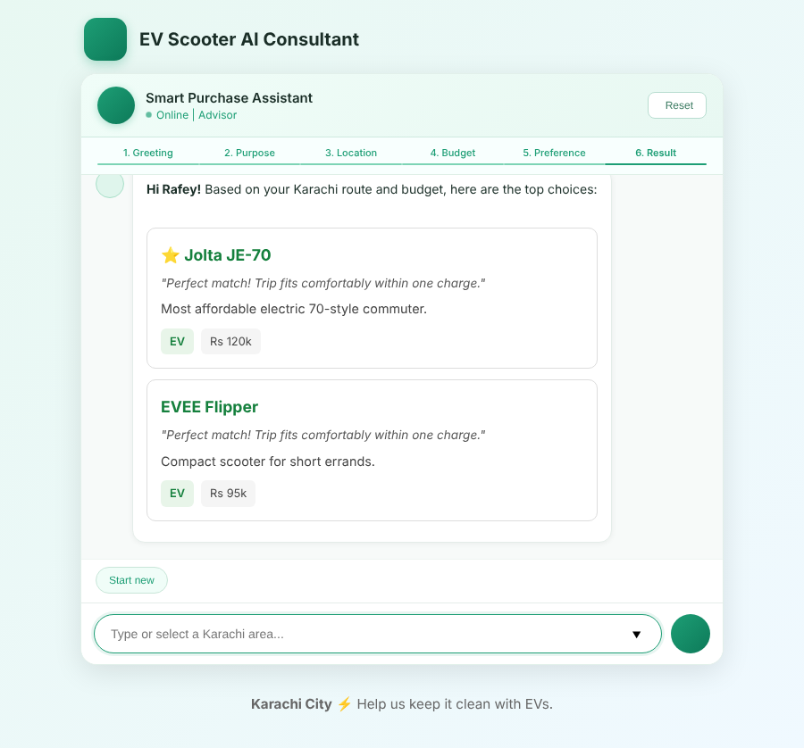
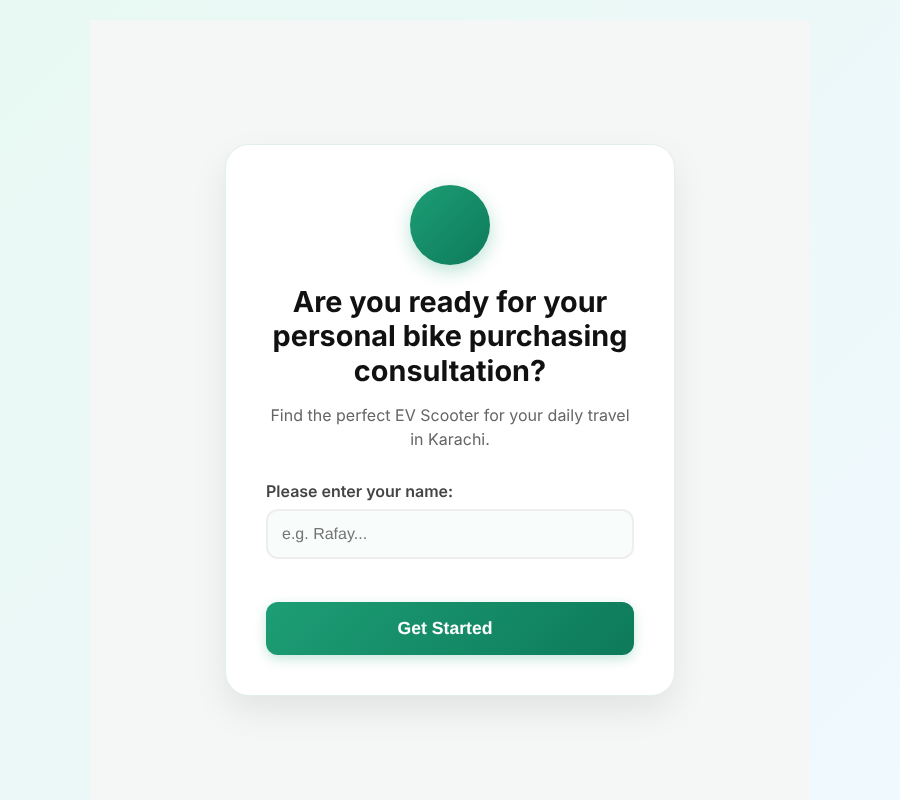
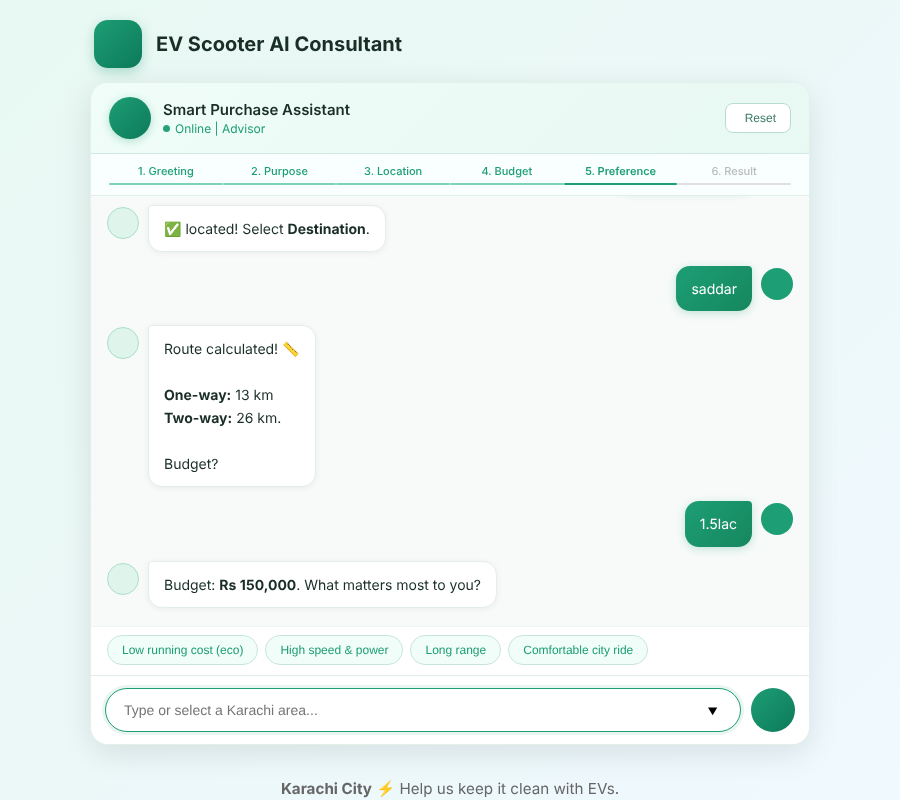

# EV Scooter AI Consultant ⚡🛵

A chat-based smart assistant that helps people in **Karachi** choose the right bike (electric scooter or petrol) based on their daily route, budget and what matters to them. Built as a semester project for the BS Artificial Intelligence program.



## What it does

1. Greets the user and asks for their **travel purpose** (university, office, groceries, hospital, gym, visiting friends).
2. Asks for a **home area** and a **destination** in Karachi, then calculates the real distance.
3. Asks for a **budget** (for example `1.5lac`).
4. Asks what matters most: low running cost, speed, range or comfort.
5. Shows the **top 2 bikes** with a short reason why each one fits.

## Features

- Multi-step chat that remembers the conversation (state is kept between messages)
- Purpose detection, with default daily distances for common trips
- Distance between two areas using the **Haversine formula**, with a 1.25 factor to approximate road distance (no external map API)
- **129 Karachi locations** in the built-in database (named areas, universities, and block/sector ranges)
- Location search with a dropdown list in the input box
- Weighted scoring engine that ranks bikes by budget, round-trip distance vs. battery range, and user preferences
- Clean, responsive chat interface

## How the recommendation works

The bike ranking is a **rule-based weighted scoring** system, written in plain JavaScript (no machine learning model and no LLM).

| Rule | Effect on score |
|------|-----------------|
| Bike price is above budget + Rs 15,000 | Bike is filtered out |
| Round trip is longer than 75 km and bike is petrol | +100 |
| Round trip fits inside the EV battery range | +30 |
| Round trip is longer than the bike range | -500 |
| User wants speed and bike speed is 60 km/h or more | +40 |
| User wants range and bike range is 100 km or more | +40 |
| User wants eco and bike is an EV | +40 |

The two highest scores are returned, each with a short reason.

## Tech stack

| Layer | Technology |
|-------|------------|
| Frontend | HTML, CSS, vanilla JavaScript |
| Backend | Node.js, Express.js, CORS |
| Distance | Haversine formula |
| Icons | Tabler Icons (CDN) |

## Project structure

```
ev-scooter-ai-consultant/
├── backend/
│   ├── server.js          # Express API and recommendation logic
│   ├── package.json
│   └── package-lock.json
├── frontend/
│   ├── index.html         # Chat page
│   ├── css/style.css      # Styling
│   └── js/app.js          # Chat logic, calls the backend API
├── docs/screenshots/      # Images used in this README
├── .gitignore
├── LICENSE
└── README.md
```

## Getting started

### Requirements
- [Node.js](https://nodejs.org) (LTS version)

### 1. Clone the repository
```bash
git clone https://github.com/abdulrafey05/ev-scooter-ai-consultant.git
cd ev-scooter-ai-consultant
```

### 2. Start the backend
```bash
cd backend
npm install
npm start
```
The server runs at `http://localhost:5000`.

### 3. Open the frontend
Open `frontend/index.html` in your browser (or use the **Live Server** extension in VS Code). Make sure the backend is running first.

## API

| Method | Endpoint | Description |
|--------|----------|-------------|
| GET | `/api/locations` | Returns all supported Karachi location names |
| POST | `/api/chat` | Takes `{ message, state }` and returns the next reply, updated `state` and quick-reply `suggestions` (or `recommendations` at the end) |

## Bikes in the knowledge base

| Model | Type | Price (PKR) | Range | Top speed |
|-------|------|-------------|-------|-----------|
| EVEE Flipper | EV | 95,000 | 50 km | 45 km/h |
| Jolta JE-70 | EV | 120,000 | 80 km | 50 km/h |
| Metro T9 | EV | 195,000 | 100 km | 45 km/h |
| EVEE C1 Pro | EV | 215,000 | 90 km | 60 km/h |
| EVEE C1 Air | EV | 310,000 | 120 km | 70 km/h |
| Honda CD70 | Petrol | 158,000 | no limit | 80 km/h |
| Honda CG125 | Petrol | 235,000 | no limit | 100 km/h |

Prices and specs are sample values for this project and may not match current market prices.

## Screenshots

| Welcome | Chat |
|---------|------|
|  |  |

## Limitations and future work

- Only covers Karachi
- The backend address (`http://localhost:5000`) is written directly in `frontend/js/app.js`
- Bike data is hard-coded; a database or live prices would make it more accurate
- Future idea: add a real language model so users can type free-form questions

## Author

**Muhammad Abdul Rafey Yashir**
BS Artificial Intelligence student, Karachi, Pakistan
- LinkedIn: [abdulrafeyyashir](https://www.linkedin.com/in/abdulrafeyyashir)
- Email: arafeyyashir@gmail.com
- Portfolio: [abdulrafey05.github.io/Portfolio](https://abdulrafey05.github.io/Portfolio/)

## License

This project is licensed under the MIT License. See the [LICENSE](LICENSE) file.
